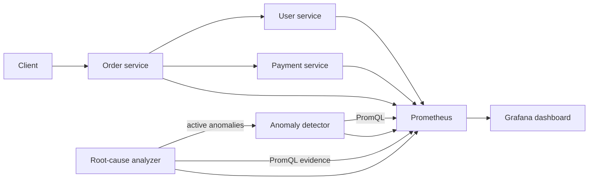
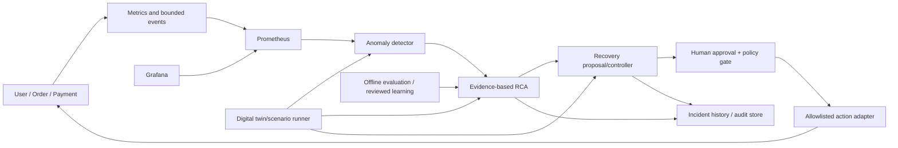

# AI-Based Self-Healing System — Master Roadmap and Handoff

**Purpose:** This is the single starting document for anyone continuing the project. It records the current implementation, architecture, repository layout, technology choices, eight-phase roadmap, boundaries, and a copy-ready continuation prompt.

**Status at handoff:** Phases 1–4 are implemented in the local demo. The latest recorded test run was `python3 -m pytest -q` with **10 passed**. Phases 5–8 below are a proposed direction, not existing implementation or previously approved requirements; confirm scope before building them.

## 1. Project objective

Build a small, inspectable self-healing system for a three-service order flow. It should detect sustained service problems, explain likely causes using evidence, and eventually recommend and execute narrowly bounded recovery actions under explicit safeguards. The project is a learning/demo system, not production-ready infrastructure.

The system must prefer safe, explainable behavior:

- Detect before diagnosing; diagnose before changing anything.
- Keep metrics and labels bounded. Never put user, order, transaction IDs, request bodies, URLs with IDs, or exception text into metric labels.
- Distinguish “healthy,” “unhealthy,” “unknown,” and “insufficient evidence.” Missing monitoring data is not evidence of recovery.
- Keep remediation allowlisted, auditable, rate-limited, and manually controllable.
- Introduce machine learning only after there is useful labeled incident history and an evaluation plan.

## 2. Current architecture



The application is three FastAPI services. The order service calls user and payment sequentially. Each service exports request/business metrics and `/health`; order also exports fixed-label dependency-call counts and latency. Prometheus scrapes every five seconds and retains seven days. The anomaly detector polls Prometheus every ten seconds and keeps anomaly state in memory. The root-cause analyzer polls the detector and Prometheus every ten seconds, ranks rule-based hypotheses, and keeps diagnosis state in memory. Grafana displays the metrics and bounded diagnosis signals. Local admin endpoints inject development failures; they are not production controls.

### Current component endpoints

| Component | Local address | Role |
| --- | --- | --- |
| User service | `http://localhost:8001` | User lookup |
| Order service | `http://localhost:8002` | Order creation and dependency calls |
| Payment service | `http://localhost:8003` | Payment authorization |
| Prometheus | `http://localhost:9090` | Metrics collection and query API |
| Grafana | `http://localhost:3000` | Provisioned overview dashboard |
| Anomaly detector | `http://localhost:8004` | `/health`, `/anomalies`, `/metrics` |
| Root-cause analyzer | `http://localhost:8005` | `/health`, `/diagnoses`, `/metrics` |

## 3. Technology stack

### Present in the project

- Python 3.12 container (`Dockerfile`)
- FastAPI `0.116.1`, Uvicorn `0.35.0`
- HTTPX `0.28.1` for service-to-service and monitoring API calls
- `prometheus-client` `0.22.1`
- Docker Compose for the local multi-service demo
- Prometheus `v2.54.1`, five-second scrape interval, seven-day retention
- Grafana `11.2.0`, provisioned Prometheus source and dashboard
- Pytest with async test support in the working environment; run with `python3 -m pytest -q`

Pin any new runtime dependency. Keep test-only dependencies separate from production runtime dependencies when the project adds a development requirements file.

### Do not add without a phase decision

No database, queue, Kubernetes, tracing collector, model-serving stack, external pager, or cloud dependency is currently required. Add these only when a phase has a concrete need, a local demo path, and acceptance criteria.

## 4. Repository layout

```text
.
├── AGENTS.md                         # Project rules; sources/ is read-only
├── README.md                         # Run instructions, endpoints, examples
├── MASTER_ROADMAP.md                 # This overview and continuation handoff
├── PHASE3_PLAN.md                    # Historical Phase 3 design/acceptance plan
├── PHASE4_PLAN.md                    # Phase 4 scope and implementation record
├── Dockerfile
├── docker-compose.yml                # Local service topology and settings
├── requirements.txt                  # Runtime Python dependencies
├── services/
│   ├── shared/                       # Metrics and development failure controls
│   ├── user/main.py                  # User service
│   ├── order/main.py                 # Orders and instrumented dependency calls
│   ├── payment/main.py               # Payment service
│   ├── anomaly_detector/main.py      # Phase 3 detector
│   └── root_cause_analyzer/main.py   # Phase 4 read-only RCA
├── monitoring/
│   ├── prometheus.yml
│   └── grafana/                      # Provisioning and dashboard JSON
├── tests/
│   ├── test_anomaly_detector.py
│   └── test_root_cause_analyzer.py
└── sources/                          # Synced reference files; treat as read-only
```

## 5. Eight-phase delivery plan

### Phase 1 — Service foundation — IMPLEMENTED

**Goal:** Establish a simple service flow that can demonstrate dependency failures.

**Delivered:** FastAPI user, order, and payment services; order calls user then payment; local development failure controls support HTTP 500, HTTP 503, and slow behavior.

**Completion bar:** Services start with Compose; successful and rejected orders work; dependency failures are observable without changing the basic APIs.

### Phase 2 — Observability baseline — IMPLEMENTED

**Goal:** Make service and business behavior measurable and visible.

**Delivered:** Prometheus metrics for request counts, durations, in-progress requests, business outcomes, target scrape health; provisioned Grafana overview; seven-day local metrics volume.

**Completion bar:** A user can create traffic, inject failures, inspect service metrics and dashboard state, and distinguish target scrape health from application behavior.

### Phase 3 — Rule-based anomaly detection — IMPLEMENTED

**Goal:** Identify sustained service symptoms without attempting automated repair.

**Delivered:** Prometheus polling; rules for target availability, 5xx rate, p95 latency, and order dependency failures; debounce and recovery windows; in-memory anomaly transitions; detector health and metrics; Grafana visibility.

**Current defaults:** Ten-second evaluation; 20-second open delay; 30-second recovery delay; 25% 5xx share with at least three requests over two minutes; one-second service p95; two dependency failure events.

**Completion bar:** Sustained injected failures open expected anomalies; one transient failure is debounced; recovery waits for a normal window; Prometheus failure marks detector unhealthy rather than resolving service anomalies.

### Phase 4 — Evidence-based root-cause analysis — IMPLEMENTED

**Goal:** Rank likely affected services/dependencies and present evidence, while leaving decisions to a person.

**Delivered:** Bounded dependency metrics from order to user/payment; root-cause analyzer; `/diagnoses`; evidence with PromQL, thresholds, time window and missing-data notes; confidence bands; unhealthy/stale state; Grafana hypothesis/evidence panels. User lookup 404 is counted as an expected dependency response.

**Current defaults:** Ten-second evaluation; two-minute evidence window; at least two calls and two failures; 50% dependency failure ratio; one-second dependency p95. State is in memory.

**Known limitation:** Aggregate metric correlation is not request-level proof. No-traffic or missing data should yield insufficient evidence. Analyzer does not take recovery actions.

**Completion bar:** Failure scenarios produce evidence-backed, appropriately uncertain hypotheses; zero traffic and monitoring loss are not called healthy; no recovery is triggered.

### Phase 5 — Guarded recovery controller — PROPOSED, NEXT

**Goal:** Turn only a small set of strong, approved diagnoses into bounded recovery actions.

**Suggested first slice:** A separate recovery controller consumes active diagnosis data and creates a proposed action. Start in dry-run mode. Require explicit human approval for every action. For the demo, prefer a narrowly scoped action such as clearing a known injected-failure state through an allowlisted development adapter. Do not mount the Docker socket or expose arbitrary shell/container commands.

**Work:**

1. Define an action registry with fixed action IDs, target services, preconditions, timeout, maximum attempts, cooldown, and expected postcondition.
2. Add policy checks: diagnosis type and confidence allowlist, action/service pairing, healthy controller inputs, no duplicate action, cooldown, and kill switch.
3. Add a read-only proposal API and a separate approval/execute path. Bind approval to a specific proposal ID and expiry so stale approvals cannot run.
4. Record proposal, approver, action, input diagnosis IDs, start/end time, result, and verification evidence in an audit record. Do not log secrets or raw request payloads.
5. After action, observe for a bounded verification window. Report `succeeded`, `failed`, or `unknown`; never claim success because a command returned zero alone.
6. Keep the controller disabled by default. Add deterministic tests for denied, approved, expired, duplicate, cooldown, kill-switch, timeout, and postcondition-failure paths.

**Acceptance:** Dry-run proposes but changes nothing. No action runs without valid approval. Only allowlisted actions execute. Repeated incidents respect cooldown. Audit records are complete. An unavailable detector/analyzer, ambiguous diagnosis, or failed verification blocks further action. Kill switch stops execution immediately.

**Out of scope:** Arbitrary commands, automatic restart of arbitrary containers, autonomous retries/rollbacks, credentials in config, production access.

### Phase 6 — Digital twin and recovery simulation — PROPOSED

**Goal:** Exercise incident and recovery policies against a safe model before applying them to the live demo.

**Suggested model:** A small deterministic simulator of the current user → order → payment graph. Represent service availability, latency, error rates, dependency edges, detection delay, recovery action delay, cooldown, and expected postconditions. Keep the model separate from live services and use scenario definitions checked into the project.

**Work:**

1. Define a versioned topology/config model for the current three services and their dependency edges.
2. Create scenarios for clean baseline, user/payment unavailable, 500/503 responses, slow dependency, order-only fault, simultaneous failures, no traffic, and Prometheus/analyzer loss.
3. Replay detector/RCA and proposed recovery rules against scenario timelines; compare expected vs observed detections, diagnoses, and action decisions.
4. Report false actions, missed detection, detection/recovery time, and uncertainty. A scenario that lacks evidence must yield unknown/no action.
5. Add a dashboard or report comparing the incident timeline with decisions. Keep simulation output clearly marked as simulated.

**Acceptance:** Scenarios are repeatable with fixed inputs. Simulation cannot call live service/admin/recovery endpoints. High-risk or ambiguous scenarios never execute actions. Changes to thresholds or policies can be compared against a baseline scenario set.

**Out of scope:** A full replica of Docker, production traffic, or a self-modifying twin.

### Phase 7 — Incident history and evaluated intelligence — PROPOSED

**Goal:** Use reviewed incident outcomes to improve diagnosis quality without weakening safety.

**Prerequisite:** Phases 3–6 have stable signals, scenario coverage, and a human review process. Do not introduce ML merely because this is an AI project.

**Work:**

1. Add a durable incident record for anomaly transitions, evidence snapshots, ranked hypotheses, human-confirmed cause, action decisions, and outcomes. Define retention and redaction rules first.
2. Add a human feedback path to label diagnosis helpful/unhelpful and confirm or correct a cause. Keep labels separate from metric labels.
3. Build offline evaluation sets from simulated scenarios and reviewed incidents. Measure top-1/top-k cause accuracy, calibration by confidence band, false positive rate, abstention quality, and regression across services.
4. First improve deterministic rules and threshold tuning from the data. If an ML or LLM assistant is later justified, run it in shadow mode and require evidence citations; it may not approve or execute recovery.
5. Version rules/models and record which version produced each diagnosis. Support rollback to the last accepted version.

**Acceptance:** No adaptive rule/model is promoted without passing the fixed evaluation set and human review. The system can abstain. Diagnosis evidence remains inspectable. Recovery authorization remains separate from learned suggestions.

**Out of scope:** Online self-training, autonomous threshold changes, numeric “probability” claims without calibration, model access to personal or payment data.

### Phase 8 — Production readiness and broader operations — PROPOSED

**Goal:** Decide whether the system is safe and maintainable beyond a local demo; harden it only for an explicitly chosen deployment target.

**Work:**

1. Select target environment, service ownership, threat model, SLOs, data retention, and recovery authority before selecting infrastructure.
2. Add authentication and role-based authorization to diagnosis, approval, and execution endpoints; protect admin/failure controls and remove demo credentials.
3. Replace in-memory state with a durable store where required. Define backup, restore, schema migration, retention, and audit tamper-resistance.
4. Add bounded retries, circuit breakers, rate limits, concurrency limits, graceful shutdown, readiness/liveness semantics, and dependency timeout budgets.
5. Define monitoring for the monitoring system itself, alerts for detector/analyzer/controller unavailability, and incident runbooks.
6. Add CI for lint/type checks, unit/integration tests, container build and security scanning; pin images and dependencies; document software updates and rollback.
7. Add deployment-specific secrets handling, network boundaries, TLS, resource limits, backup/restore test, staged rollout, and rollback plan.
8. Expand beyond the three-service graph only through versioned topology and service onboarding rules; keep cardinality and action policies bounded.

**Acceptance:** A documented threat model and operational owner exist. Unauthenticated users cannot diagnose sensitive data or trigger actions. Recovery, audit, backup/restore, rollback, service-loss, and monitoring-loss procedures are tested in the chosen environment. No demo password/default admin credential remains.

**Out of scope:** Choosing Kubernetes/cloud products before deployment requirements are agreed; claiming production readiness based on local Compose tests.

## 6. Target architecture evolution

Phases 5–8 may add these components, in order and only when accepted:



This is a future sketch, not current code. The simulator must not reach live action adapters. The intelligence/evaluation path must not bypass approval.

## 7. Handoff instructions for the next coding assistant

- Start by reading `AGENTS.md`, this file, `README.md`, `PHASE3_PLAN.md`, and `PHASE4_PLAN.md`.
- Treat all files under `sources/` as read-only. They may be refreshed from the ChatGPT project mirror.
- The current workspace path is `/Users/naurinnizar/.codex/.chatgpt-projects/g-p-6a89660fd36881918a06f2fadc1f5da6`. This is a Codex project mirror, not a Git repository. If moving to a normal folder for Antigravity, make an independent copy; initialize Git in the copy if version history is desired. A Git remote is optional for local Antigravity work.
- Preserve Phases 1–4. Do not rebuild them just because the next workspace or assistant is new.
- Before coding, inspect the actual tree and current tests. If working from a copied folder, confirm its path and whether it has a Git remote; do not assume either.
- The next proposed work is Phase 5. Implement only the first small guarded-recovery slice and its tests; keep dry-run/default-off behavior. Do not add Docker socket access or arbitrary command execution.
- Run `python3 -m pytest -q` after code changes. The last recorded run had 10 passing tests; update this baseline if tests or behavior change.
- Mark planned decisions, assumptions, and risks clearly. Update this roadmap and README when a phase is completed.

### Copy-ready continuation prompt

> Continue the AI-Based Self-Healing System from this workspace. First read `AGENTS.md`, `MASTER_ROADMAP.md`, `README.md`, `PHASE3_PLAN.md`, and `PHASE4_PLAN.md`. Preserve the implemented Phases 1–4 and treat `sources/` as read-only. Inspect the current files and tests before changing anything. The proposed next stage is Phase 5 (guarded recovery), but confirm its acceptance criteria from the roadmap and implement only a small, dry-run-first, allowlisted action with human approval, audit history, cooldown, and kill switch. Never add arbitrary command execution or Docker socket access. Run `python3 -m pytest -q` after changes and report changed files, behavior, test results, and remaining risks. If this workspace is a copied folder, use its actual path and Git state rather than assuming the Codex mirror path.
